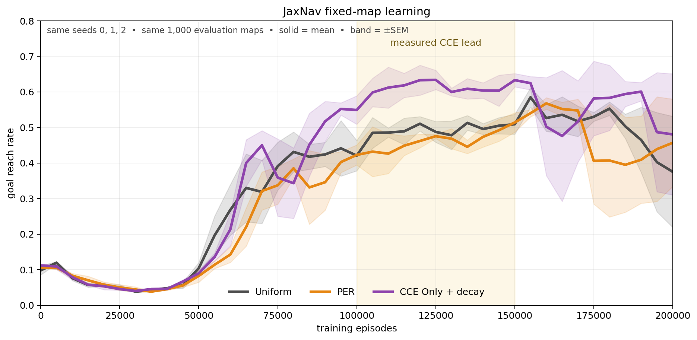

# Counterfactual Reasoning for Replay Prioritization

This repository studies one question:

> Can counterfactual consequence scores improve which transitions a replay
> buffer samples?

CCE asks: **what would have happened if the agent had acted differently here?**
Transitions with larger downstream differences receive more replay attention.

```text
new transition
      |
      v
try other actions in the simulator
      |
      v
measure how different their futures are
      |
      v
large difference -> replay more often
```

The package contains shared CCE scoring and replay math. Training and analysis
are reusable engines. Actual research questions live in experiment bundles.

## Result snapshot

| Environment | Uniform | PER | CCE | What the result says |
|---|---:|---:|---:|---|
| FrozenLake 8x8, deterministic | 10/25 seeds solved | 12/25 | **20/25** | CCE escapes the dead learning basin more often. |
| JaxNav 8x8, fixed 1,000-map bank, 100k–150k window | 48.9% | 46.0% | **60.8%** | CCE learns earlier: +11.9 points over Uniform and +14.8 over PER. |

The JaxNav numbers are means over matched seeds 0, 1, and 2. The lead is a
mid-training sample-efficiency result. It is **not** a final-200k performance
win; the curves later converge or collapse.

## Policy demos

### Deterministic FrozenLake

Same map. Same training seed. Final checkpoints. CCE reaches the goal in this
matched example; Uniform and PER time out.


[MP4](docs/media/demos/frozenlake_comparison.mp4) ·
[checkpoint hashes and outcomes](docs/media/demos/frozenlake_provenance.json)

The animation is one matched seed. The result is the 25-seed count above, not
the single rollout.

### Fixed-map JaxNav

This is the latest matched CCE-only experiment with the fixed collector and a
shift to ranked TD from 100k to 150k episodes.



The rollout below uses training seed 0, the checkpoint nearest 125k episodes,
and **map 0** from the shared evaluation bank. Map 0 was fixed before outcomes
were viewed. It was not selected to make CCE look good.


[MP4](docs/media/demos/jaxnav_comparison.mp4) ·
[checkpoint hashes and rollout outcomes](docs/media/demos/jaxnav_provenance.json) ·
[curve values and log hashes](docs/media/demos/jaxnav_learning_curve.json) ·
[rebuild instructions](docs/media/demos/README.md)

## Layout

```text
src/counterfactual_rl/
  replay/                 replay buffers and priority schedules
  scoring/                consequence metrics

training/
  envs/                   task state, actions, reset, and step rules
  learners/<environment>/ training implementations
  run.py                  one training entry point
  catalog.py              recipe inventory and validation

analysis/
  plotting/               comparable learning curves
  studies/                reusable result-reading code

experiments/
  <environment>/<name>/   README plus training and/or analysis recipe

tests/                    fast merge gate
paper/                    paper source and reproducibility cache
```

Detailed migration evidence was removed from the normal tree. It remains
recoverable from the commit listed in [docs/migration-audit.md](docs/migration-audit.md).

## Supported experiment adapters

| Adapter | Task |
|---|---|
| `jaxnav` | Random navigation maps |
| `frozenlake` | Deterministic and stochastic FrozenLake |
| `doorkey` | DoorKey and lava layouts |
| `connect_four` | Fixed and historical Connect Four protocols |
| `smax` | Multi-agent SMAX |
| `chess` | Gardner chess environment |
| `cvrp` | Tabular routing |
| `rpdqn` | Neural routing |
| `cvrp_budget` | Budget and Option-A routing variants |

Each adapter provides the same small interface:

```text
validate_config
build_agent
smoke_overrides
evaluation_axis
simulator_sources
```

Environment-specific choices stay behind that interface.

## Install

Python 3.12 is required.

```bash
python3.12 -m venv .venv
source .venv/bin/activate
pip install -e '.[research,dev]'
```

Historical JaxNav runs used a dependency combination that modern package
resolvers reject. Use the pinned instructions in
[docs/migration-install.md](docs/migration-install.md) when exact historical
behavior matters.

## Find runnable recipes

```bash
python -m training.catalog --root .
```

Recipe validation is lazy. It does not import JAX or a simulator.

## Validate a run

```bash
cce-run validate \
  --recipe experiments/jaxnav/ranked-td-decay/training.json \
  --task 1
```

## Run a bounded smoke test

```bash
cce-run train \
  --recipe experiments/frozenlake/smoke/training.json \
  --task 0 \
  --smoke \
  --device cpu \
  --max-wall-seconds 180 \
  --output /tmp/cce-frozenlake-smoke
```

`--smoke` changes compute settings. It is a code check, not a research result.
Normal runs keep the recipe unchanged.

## Run a full recipe

```bash
cce-run train \
  --recipe experiments/cvrp_budget/budget/training.json \
  --task 0 \
  --device gpu \
  --max-wall-seconds 86400 \
  --output /path/to/fresh/run
```

The output folder must not already exist. Every attempt records:

- the resolved configuration;
- package and device versions;
- project and simulator source hashes;
- a compressed source bundle;
- evaluation-bank identity when the learner has one;
- completion or failure state.

## Plot comparable runs

```bash
python -m analysis.plotting.learning_curves \
  --runs /path/to/run-a /path/to/run-b \
  --bin-size 5000 \
  --output /tmp/learning-curves.png
```

The plotter rejects mixed evaluation banks, simulator source, map settings,
duplicate seeds, and incompatible training clocks.

## Run an analysis

```bash
cce-study \
  --config experiments/frozenlake/claim2-deterministic/analysis.json \
  --out /tmp/cce-claim2
```

Analysis recipes are not training jobs. Cached data is not a new experiment.

## Test

```bash
PYTHONPATH=.:src pytest -q
```

The normal gate covers environment dynamics, recipe validation, package
contracts, source capture, and plotting guards. Large one-time migration audits
live in Git history instead of the normal test suite.

## Research status

The strongest learning result is deterministic FrozenLake. The latest JaxNav
study shows a clear mid-training lead on a fixed evaluation bank, followed by
late instability. This repository keeps both the gain and that limit visible.

The migration has strong CPU checks and a fresh-wheel validation path. Two
full-size JaxNav GPU tasks matched numerically. A third stopped on tiny
old-versus-old float noise before its candidate ran, so the full-budget gate is
incomplete. See [docs/migration-audit.md](docs/migration-audit.md).

The current paper source is [paper/paper.tex](paper/paper.tex). Research notes
are in [lab-notebook.md](lab-notebook.md).
