# Counterfactual Reasoning for Replay Prioritization

> Can an agent learn faster if it replays the moments where its choice mattered most?

**Status: in progress.** Paper draft in [`paper/paper.tex`](paper/paper.tex). Since January 2026
the project has run about 6,600 jobs on MSOE's Rosie cluster, roughly 12,600 GPU-hours.
This README covers what worked, what didn't, and what we still don't know.

A DQN agent learns from a replay buffer of past transitions. Standard prioritized replay
(PER) replays transitions with large TD error, the ones the network predicted badly.
Counterfactual Consequence Estimation (CCE) asks a different question about each stored
transition: *what would have happened if the agent had acted differently here?* If the
alternative actions lead to very different futures, the moment was consequential, and it
gets replayed more.

```text
new transition
      |
      v
try other actions in the simulator
      |
      v
measure how different their futures are
      |
      v
large difference -> replay more often
```

---

## The method, step by step

### 1. Roll out every action from the stored state

From a stored state s<sub>t</sub>, take each available action *a* and let the current
policy play out the rest of the episode *n* times. Each rollout gives a discounted return:

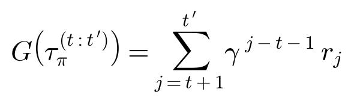

The returns for one action form a distribution over outcomes:

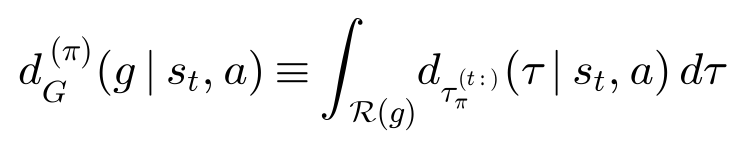

### 2. Score how far apart the distributions are

The consequence score m<sup>C</sup><sub>j</sub> is a distance between the per-action return
distributions. The paper version uses total variation (TV) over 50-bin histograms. Later
runs use Wasserstein, because TV is always zero with a single rollout.

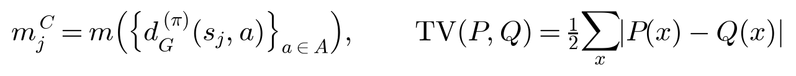

Here are steps 1 and 2 on real FrozenLake rollouts. At the top state, the taken action
almost always reaches the goal, and the alternatives often fall in a hole (return 0), so the
score is high. At the bottom state, every action usually ends in a hole, so the choice barely
matters and the score is near zero.

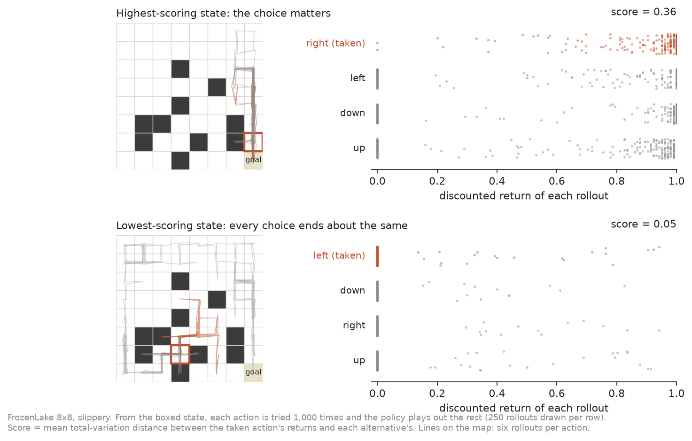

### 3. Turn scores into sampling probabilities

PER turns TD error into a sampling probability. CCE does the same with the consequence
score. In code, ε = 0.01 and β = 0.25.

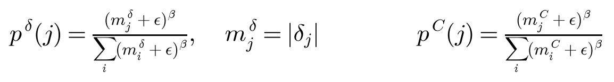

β sets how hard the scores push. At β = 1, the top FrozenLake state is replayed 5x as often
as the bottom one. At the β = 0.25 we used, the gap is only 1.5x. That turns out to matter
(see [What didn't work](#what-didnt-work)).

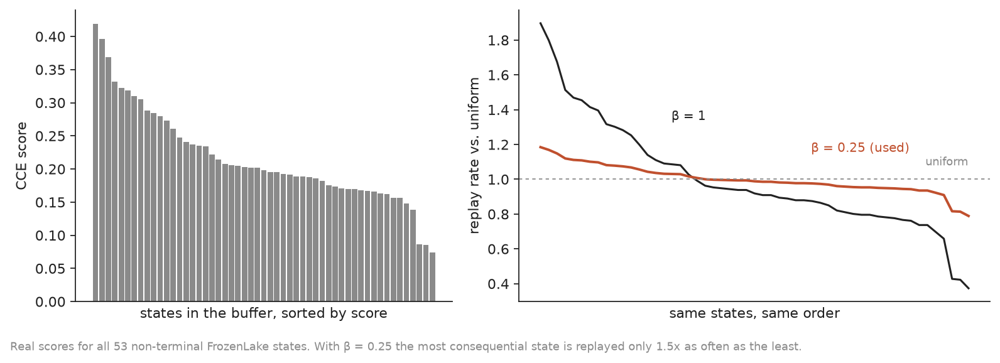

### 4. Mix the two signals

We tested two blends. The additive one weights them with μ:

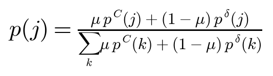

The multiplicative one puts the most weight on transitions that score high on *both*:

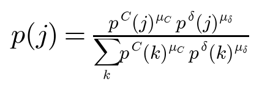

### 5. Learn

Sampled transitions get an importance-sampling weight and a standard (optionally Double) DQN
update:

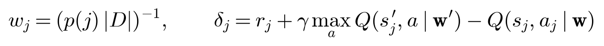

New transitions enter the buffer with the mean CCE score and the max TD priority, so each
one is likely to be sampled before it is scored.

---

## Claim 1: the score finds the moments that matter

To test the score on its own, apart from any learning gains, we compare it with an exact
answer. In FrozenLake and a small routing task (CVRP), value iteration gives the true
Q<sup>⋆</sup>. The oracle importance of a state is the average cost of not taking the best
action:

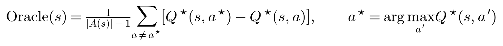

We report the Spearman rank correlation ρ between the CCE score and the oracle. It rises as
the policy gets better:

| Environment | Untrained | Mid-training | Trained |
|---|---:|---:|---:|
| FrozenLake 8x8, slippery (53 states) | 0.32 | 0.77 | **0.89** |
| CVRP routing (10 seeds) | 0.58 | 0.77 | 0.74 |

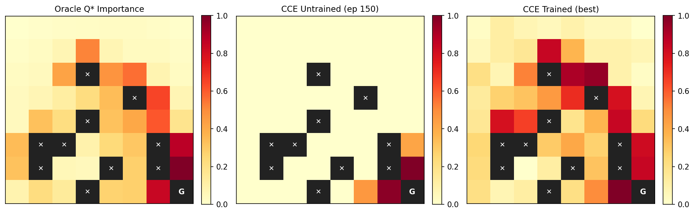

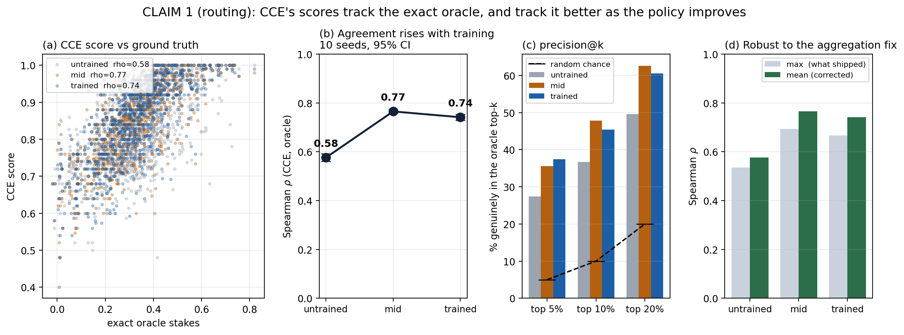

This is the most solid result. The score measures what it claims to measure, and gets
better at it as the policy improves.

---

## Claim 2: does it speed learning?

### Where it works: deterministic FrozenLake

On 8x8 FrozenLake without slip, most seeds of every method get stuck and never find the goal.
CCE gets out of that trap more often:

| Arm | Seeds solved (of 25) |
|---|---:|
| DQN, uniform replay | 10 |
| DQN + PER | 12 |
| CCE only | 14 |
| CCE + TD, additive | 16 |
| **CCE + TD, multiplicative** | **20** |

A 20-seed rerun gave 18/20 for CCE + TD (multiplicative) and 10/20 for PER.

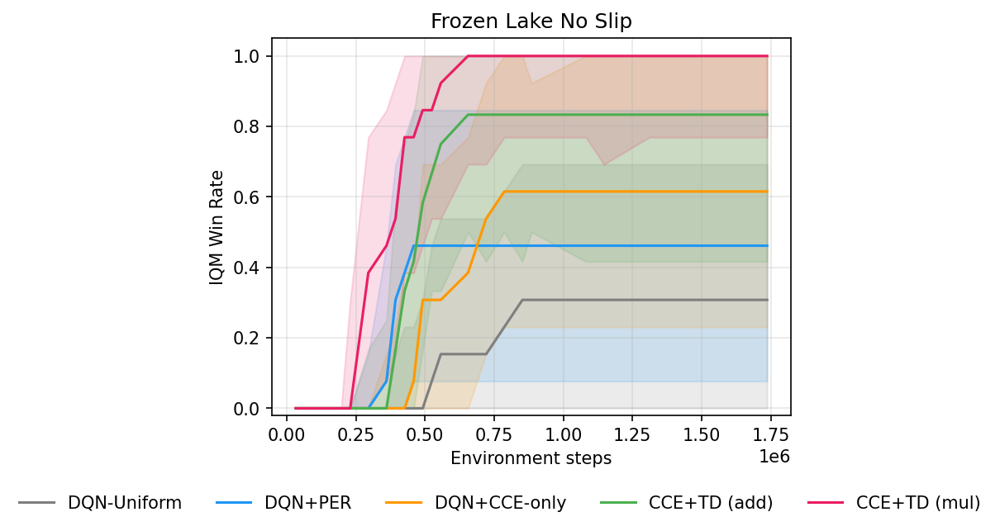

Same map, same training seed, final checkpoints. CCE reaches the goal; uniform and PER time out.

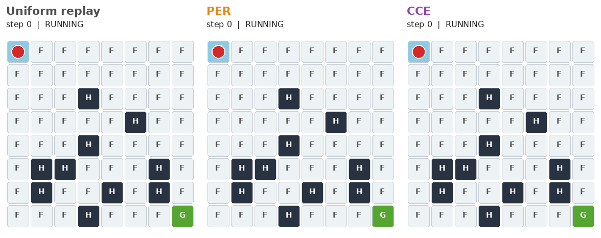

*One matched seed for illustration. The result is the seed count above.* ·
[MP4](docs/media/demos/frozenlake_comparison.mp4) ·
[provenance](docs/media/demos/frozenlake_provenance.json)

### A partial win: JaxNav, mid-training

JaxNav is a 2D robot navigation task with random obstacle maps. Our latest experiment
(October 2026) used CCE only, shifting to ranked TD between 100k and 150k episodes, with 3
seeds per arm. Every arm was evaluated on the same 1,000 fixed maps. From about 90k episodes,
CCE pulls ahead, and it holds roughly a 12-point lead over uniform through the middle of
training:

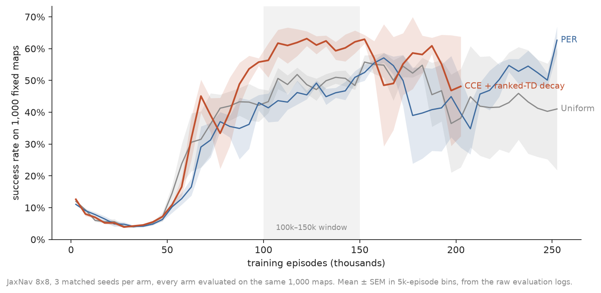

| 100k–150k episode window | Uniform | PER | CCE + ranked-TD decay |
|---|---:|---:|---:|
| Success rate | 48.9% | 46.0% | **60.8%** |
| Lead of CCE | +11.9 pts | +14.8 pts | |

This is a sample-efficiency lead only. After 150k the CCE curve drops back to the others,
and the run ended at 200k.

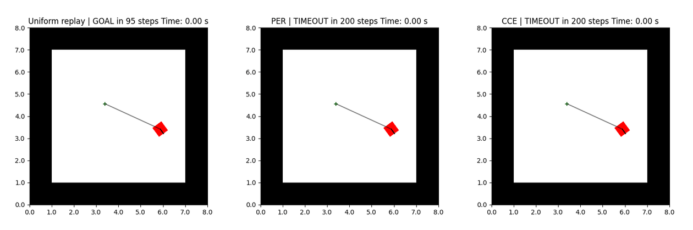

*These four maps were picked because CCE succeeds on them. The curve above is the fair
comparison.* · [MP4](docs/media/demos/jaxnav_comparison.mp4) ·
[provenance](docs/media/demos/jaxnav_provenance.json) ·
[curve data](docs/media/demos/jaxnav_learning_curve.json)

---

## What didn't work

The FrozenLake win does not carry over to the harder settings we tried. These failures are
the main reason the project is still open.

**Add a little noise and the win disappears.** In a sweep of 560 runs we varied FrozenLake's
slip probability from 0 to 0.133, with 20 seeds per cell. CCE + TD beat PER only at slip 0
(+8 of 20 seeds, 95% CI [+0.15, +0.65]). At every slip level from 0.02 up, the interval
includes zero, and CCE-only collapses to 0–1 solved seeds. Fully slippery FrozenLake is a
tie, with every arm between 0.67 and 0.75 IQM.

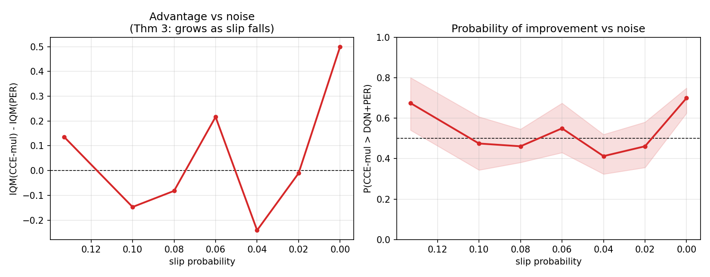

**Deterministic rollouts flatten the score.** Without slip, rollouts barely vary. Only about
4% of states get a nonzero score (47% when slippery). So Claim 1 is measured on slippery
FrozenLake and Claim 2's win comes from deterministic FrozenLake. That gap is unresolved.

**Routing: about 2,500 runs, no gain.** On CVRP, CCE tracks the oracle (Claim 1 above) but
never beat PER at learning. Every configuration tied. We pre-registered an inverted-U
prediction over the fuel budget, and the data falsified it.

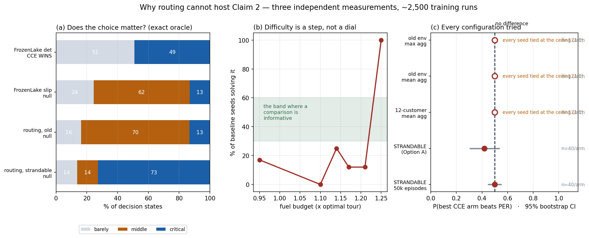

**DoorKey: everyone solves it.** All arms reach the ceiling, so there is nothing to separate
them. Adding lava made both claims worse. Greedy rollouts fail once they leave the learned
path, and "died" and "timed out" return the same value.

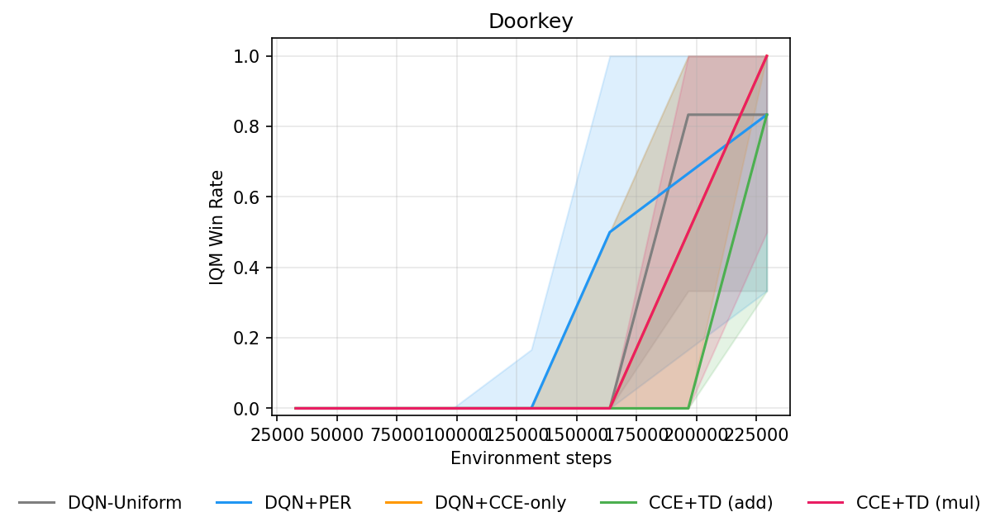

**JaxNav: the stability win faded with more training.** At 150k episodes, PER collapsed
(dropped more than 25 points below its own peak) on 7 of 25 seeds and CCE on 0–1. By 500k,
every arm collapsed often: uniform 14/25, PER 9/25, CCE (max) 7/25, CCE (mean) 11/25.

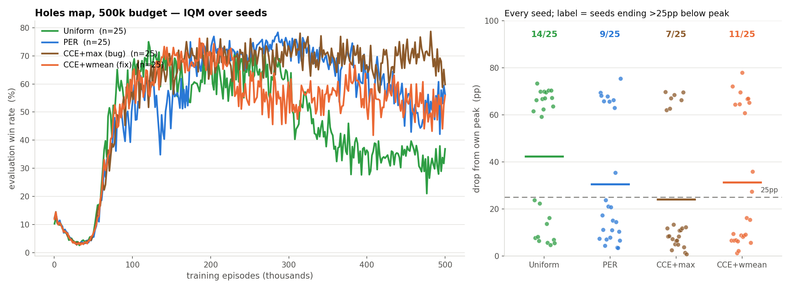

**A better score changed nothing.** One fix tripled the mean CCE score, yet replay barely
changed (+1%) and the final win rate did not move. With β = 0.25, priorities stay close to
uniform: no transition is sampled more than about 3x as often as another.

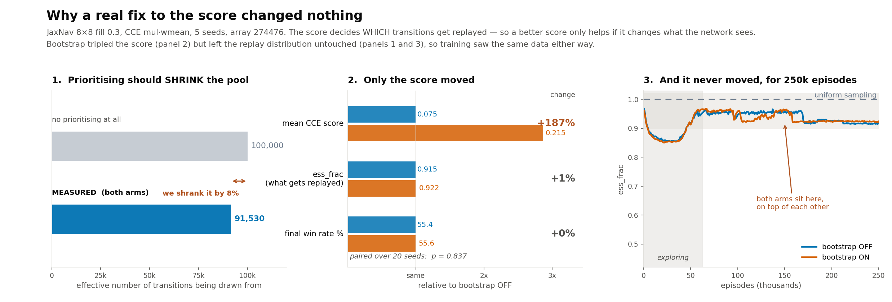

**Small buffers fail for a reason unrelated to CCE.** When the buffer is small, it fills
with new data faster than the target network updates. Few successful episodes stay in it.
That is catastrophic forgetting, and every arm suffers from it.

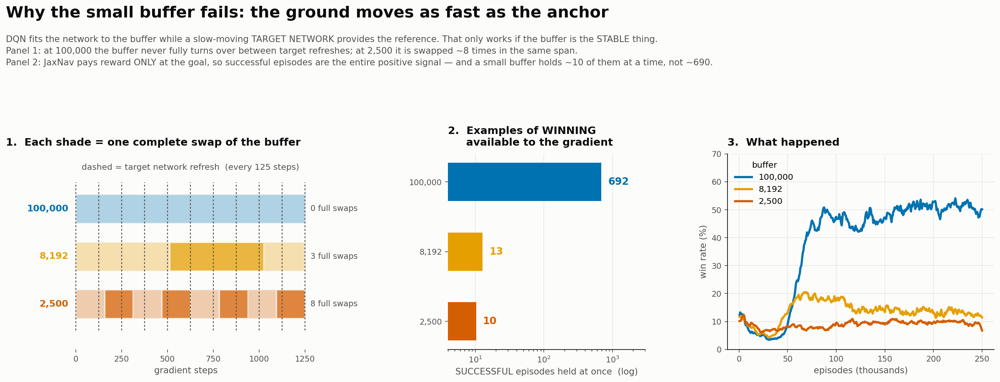

**Two early JaxNav "wins" were bugs.**
- *Obstacles:* `fill=0.1` sounds like 10% obstacles. It actually gave about 2.5% obstacles
  and 36% completely empty maps.
- *Coverage:* only 0.86% of the buffer was ever scored. Scoring on insert raised coverage to
  100%. But a 240-run test showed coverage was not why JaxNav came out null.

**Chess and Connect Four were dropped.** The chess value network died (dead ReLUs) and its
oracle was too weak. Connect Four had bugs, so it was never fairly tested.

**It is expensive.** CCE + TD takes 2.2–2.3x the wall-clock time of uniform replay on
FrozenLake, and CCE-only takes 3.3x. On SMAX (multi-agent) the cost is 1.3–1.4x, and the
gain is marginal: 0.722 IQM vs 0.710 for PER.

> [!CAUTION]
> **Known issues in past results**
> - The aggregation labeled `weighted_mean` actually ran as `max` in every FrozenLake and
>   CVRP run, and in JaxNav runs before 08-13. Recomputing Claim 1 with `mean` gives
>   FrozenLake ρ 0.33 / 0.79 / 0.90 and CVRP 0.58 / 0.77 / 0.74, so the result holds. The
>   paper's method text still needs fixing.
> - Until PR #34 (2026-10-14), our PER baseline inserted new transitions at priority 1.0
>   instead of the running max, as standard PER does. All PER numbers above come from
>   that version.
> - The current recipe (Wasserstein, rank normalization, score-on-insert, one greedy
>   rollout over horizon 60) differs from the paper's (TV, 20 rollouts, periodic scoring).

---

## What's next

- Sparse Four Rooms: a task where one decision (which door) decides the episode. Runs
  launched 2026-10-15.
- MinAtar Breakout, then DeepSea: candidate environments where consequential moments are
  rare and the outcome depends on them.
- Bring the paper in line with the code and the results above.

---

## Quickstart

Python 3.12.

```bash
python3.12 -m venv .venv && source .venv/bin/activate
pip install -e '.[research,dev]'
python -m training.catalog --root .          # list recipes
cce-run train --recipe experiments/frozenlake/smoke/training.json \
  --task 0 --smoke --device cpu --max-wall-seconds 180 --output /tmp/cce-smoke
PYTHONPATH=.:src pytest -q
```

Layout, adapters, full runs, plotting, and analysis: [docs/USAGE.md](docs/USAGE.md).
Research log: [lab-notebook.md](lab-notebook.md). Figure provenance for this page:
[docs/figures/readme/PROVENANCE.md](docs/figures/readme/PROVENANCE.md).

## Team

Adrián Manchado and Jeremy Kedziora, Milwaukee School of Engineering.
